  
  
  

# 👋 Hola

Soy Juan Pablo, estudiante de la **Escuela Superior Politécnica del Litoral (ESPOL)** en Guayaquil, Ecuador. Me apasionan los videojuegos y siempre estoy dispuesto a aprender cosas nuevas.

Tengo conocimientos en Python, me gusta SQL y estoy aprendiendo más sobre HTML, CSS, JavaScript, TypeScript y React.

> 💪 **Hazlo incluso cansado.**

## 🚀 Mis proyectos

  
  
  

- **Conversor de bases numéricas**: Assembly x86 de 16 bits (emu8086). Convierte entre decimal, binario y hexadecimal con validación de entrada.
- **NidU**: prototipo web en HTML, CSS y JavaScript para conectar estudiantes foráneos de Guayaquil con arriendos cercanos.
- **SRVP-SBD**: base de datos de un servicio de renta y venta de videojuegos, con una aplicación CRUD en Python.

## 🧰 Mi caja de herramientas

  &nbsp;&nbsp;
  &nbsp;&nbsp;
  &nbsp;&nbsp;
  &nbsp;&nbsp;
  &nbsp;&nbsp;
  &nbsp;&nbsp;
  &nbsp;&nbsp;
  

Además: **SQL** y **Assembly x86**.

## 📊 Estadísticas

  
  

